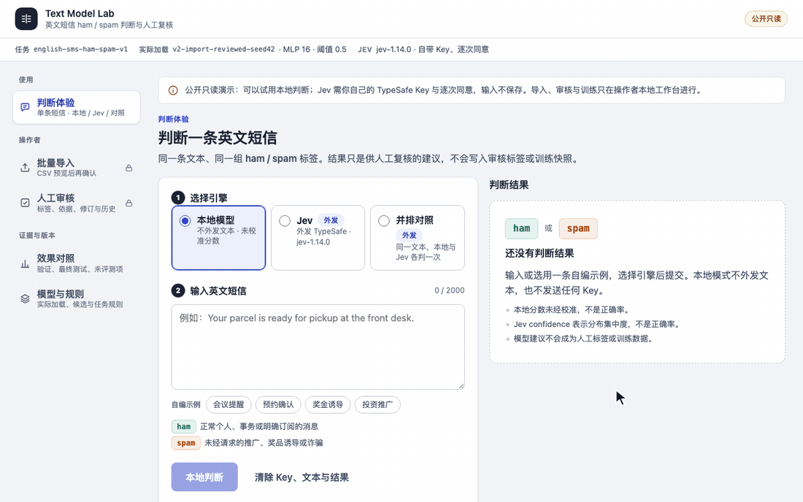
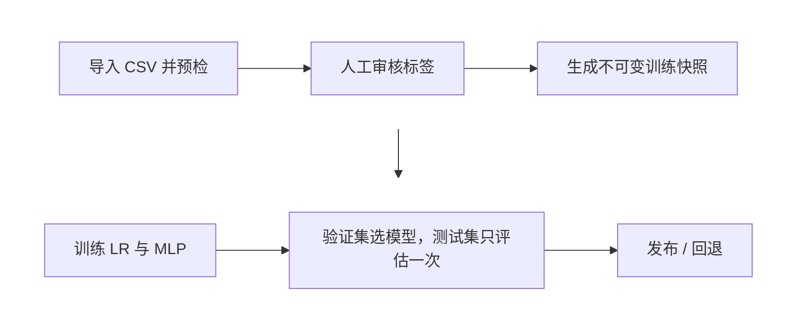

# Text Model Lab

**从数据审核到模型上线的文本分类平台。**

Python · FastAPI · SQLite · scikit-learn · PyTorch · NumPy · Vue 3

[在线演示](https://textlab.madokanun.top/workbench/) · [版本历史](docs/HISTORY.md) · [Jev 接口约定](docs/JEV_API_CONTRACT.md)

## 解决什么问题

模型分数常因数据泄漏而虚高，标签改了也说不清线上模型用的是哪批数据。Text Model Lab 以英文垃圾短信识别为例，打通“导入 → 人工审核 → 训练 → 评测 → 发布 / 回退”的可追溯流程。



<sub>动图展示公开只读界面：用本地模型判断两条自编短信，换一条输入时上一次的结果会被清除，最后在“效果对照”查看已有的最终测试结果。它展示操作流程，不是新的模型质量评测。</sub>

## 怎么工作



每次训练都记录用了哪个快照、什么配置、得到什么指标；线上预测会返回实际加载的模型版本。

## 关键设计

1. **按“模板组”划分数据，冻结后做一次最终测试。** 先合并归一化模板相同的短信，再对词项阻塞筛出的候选计算字符 5-gram Jaccard 相似度（≥ 0.85），把命中的近重复候选归为一组；这覆盖预定模板和词法候选，不保证识别所有语义改写。按组哈希以 70/15/15 为目标比例划分训练、验证和测试；TF-IDF + 逻辑回归与 PyTorch 小型 MLP 对照，根据验证集结果选择模型，本轮阈值固定为 0.5，冻结方案后对封存测试集评估一次。分组用于减少模板跨集合泄漏，测试结果不再用于调整这一版本。
2. **每个模型都能追溯到它用的那批数据。** FastAPI + SQLite 实现 CSV 导入预检、人工审核（乐观锁防并发覆盖，标签与修改历史在同一事务写入）和不可变训练快照，每次训练记录数据版本、配置与指标，并支持模型选择与回退；这样标签改了，也能说清线上模型用的是哪批数据。
3. **线上只加载纯数值模型。** 模型导出为 JSON/NPZ 纯数值格式，线上推断不依赖 PyTorch / sklearn、也不加载 pickle，减少线上运行依赖，并避开 pickle 反序列化执行代码的风险。Vue 3 前端丢弃过期响应，并支持本地模型与外部 AI 模型（TypeSafe Jev）并排判断、标出分歧，供人工复核。

## 结果

| 指标 | 结果 | 出处 |
| --- | --- | --- |
| 测试集 macro-F1（757 条，方案冻结后只评估一次） | **0.952** | [最终测试报告](artifacts/v2-verification/final-test-report.json) |
| 正常短信被误判为垃圾短信 | **0 条** | [最终测试报告](artifacts/v2-verification/final-test-report.json) |
| 垃圾短信精确率 / 召回率 | **1.00 / 0.84** | [最终测试报告](artifacts/v2-verification/final-test-report.json) |
| 验证集 macro-F1（用来选模型） | 逻辑回归 0.949，MLP 0.974，选 MLP；该轮训练快照含 3623 条样本，其中 4 条为 AI 编写烟测新增 | [训练记录](artifacts/v2-verification/import-training-workflow.json) |
| 去重与初始按组划分 | 5574 条原始短信去掉 415 条重复，按 5004 个组划分为训练 3619 / 验证 783 / 测试 757 条 | [数据审计](artifacts/v2-verification/data-audit.json) |
| 线上推断内存峰值（2026-10-28 小规模试运行） | 约 **44 MiB**（记录值 43.57 MiB），不是持续负载容量结论 | [部署摘要](artifacts/v2-verification/deployment-summary.json) |
| 自动化测试（2026-11-01 本地复核） | **36** 项 Python、**45** 项前端，生产构建通过 | 本地执行下方 `unittest`、`npm test` 与 `npm run build` 命令；历史结果见[项目状态](PROJECT_STATUS.md) |

## 局限

- 只覆盖英文短信 ham/spam 二分类和一份公开数据集（UCI），测试结果不代表线上流量或中文效果。
- 基线使用公开 UCI 数据；导入审核到重训的新增样本链路使用 4 条 AI 编写烟测短信，没有真实错标纠正，不能说明数据质量提升。
- 尚未完成真实 Jev 调用验收或正式质量评测；公开站只读，导入、审核和训练只在本地私有工作台进行，训练由 CLI 启动。

## 在线演示和快速开始

**在线演示：<https://textlab.madokanun.top/workbench/>**（公开只读）。默认用本地模型判断，不需要 Key；选 Jev 或并排对照时，要填自己的 TypeSafe Key，并同意把这条文本发给 TypeSafe。浏览器仅在页内内存保留 Key，提交时经同源 HTTPS 交给后端作单次请求，不写入浏览器存储或数据库；超时或取消仍可能已产生模型费用，不自动重试。“效果对照”和“模型与规则”可以查看验证、测试结果和当前加载的模型；“批量导入”和“人工审核”只在本地私有工作台开放。

**本地运行**（Python 3.13，macOS / Linux）。下面是完整的本地训练流程，只想看界面用在线演示即可；已有工作库不要重复初始化，要建新的数据版本时在子命令前加 `--root /绝对路径`，用独立目录，不要覆盖已有的模型、报告和评估记录：

```sh
python3.13 -m venv .venv
.venv/bin/python -m pip install -r requirements-backend.txt
.venv/bin/python baseline.py download
.venv/bin/python workbench.py prepare
.venv/bin/python workbench.py create-token
.venv/bin/python workbench.py snapshot
```

`snapshot` 会输出 `snapshot_id`。用它和一个新的 run 名训练（已存在的 run 不会被覆盖），再选择模型并启动：

```sh
.venv/bin/python workbench.py train --snapshot '<snapshot_id>' --run my-first-run
.venv/bin/python workbench.py select --run my-first-run --kind lr --threshold 0.5
.venv/bin/python workbench.py serve --port 8765
```

打开 <http://127.0.0.1:8765/workbench/>。管理令牌保存在被 Git 忽略的 `var/operator-token.txt`（权限 0600），需要时私下复制到页面的密码框，令牌只留在页面内存，不要贴到聊天或 Git；`serve` 会自己读取这个文件。数据和产物默认写在被 Git 忽略的 `var/`。`app.py` 和 `baseline.py` 是 v1 的兼容入口，完整新流程用 `app_v2:create_app` 和 `workbench.py`。

**导入新数据。** CSV 列为 `text,label`，标签只能是 `ham` 或 `spam`；单个文件最多 5 MiB、10000 行，单条 2000 字符，待审核池累计最多 20000 行。预览会列出空值或非法标签、重复、标签冲突和与留出集重叠的数量，确认后只导入可接受的新行。命令行流程如下（`examples/authored_sms.csv` 是 AI 编写的 4 条流程测试样本，不是真实业务数据）：

```sh
.venv/bin/python workbench.py preview examples/authored_sms.csv --source 'AI-authored workflow examples, not field data'
.venv/bin/python workbench.py confirm '<preview_id>'
```

导入的行要逐条审核（网页“人工审核”，或 `review` 子命令带上样本 ID、标签、依据和当前 revision）后才进入新快照，之后用新的 run 名重新训练。

**公开部署（只读推断）。** 先选定模型再导出公开包，目标目录必须不存在：

```sh
.venv/bin/python workbench.py export-public deploy/public-bundle
```

服务器用独立虚拟环境按 `requirements-inference.txt` 安装（不含 PyTorch 和 scikit-learn），只监听本机回环，由 HTTPS 反向代理对外：

```sh
SMS_LAB_ROOT=/绝对路径/public-bundle SMS_LAB_PUBLIC=true .venv/bin/python -m uvicorn app_v2:create_app --factory --host 127.0.0.1 --port 3111 --workers 1 --no-access-log --proxy-headers --forwarded-allow-ips=127.0.0.1
```

公开包只有选定模型的数值权重、词表、来源报告和服务清单，不含数据库、快照、导入的 CSV 或留出集原文。`SMS_LAB_PUBLIC=true` 时，即使带着管理令牌也不能导入、审核、生成快照或切换模型。线上用 `SMS_LAB_JEV_ENABLED=true` 开放 Jev 对照、`SMS_LAB_JEV_SERVER_KEY_ENABLED=false` 关闭服务器 Key，访客只能用自己的 Key。

**运行测试**（只用自编临时数据和模拟的外部接口；Jev 脚本默认不联网，不要加 `--live`）：

```sh
.venv/bin/python -m unittest discover -s tests -v
npm test --prefix frontend
npm run build --prefix frontend
.venv/bin/python scripts/verify_jev.py
```

## 文档

- [Jev 接口约定](docs/JEV_API_CONTRACT.md)与 [Jev 评测计划](docs/JEV_EVALUATION_PLAN.md)
- [版本历史与详细说明](docs/HISTORY.md)：域名变更、版本说明、各版本验收记录和详细的使用边界；当前状态见[项目状态](PROJECT_STATUS.md)
- [AI 协作过程文件](docs/process/)：交接文档、启动提示和交付记录。本项目借助 AI 编程助手开发。

## 数据来源与许可

短信数据来自 Almeida 与 Hidalgo 的 [UCI SMS Spam Collection](https://archive.ics.uci.edu/dataset/228/sms+spam+collection)（DOI `10.24432/C5CC84`，UCI 页面列出的许可为 CC BY 4.0）。仓库在 `data/` 保留原 readme 和来源哈希，原始数据用 `baseline.py download` 下载。数据许可与源码许可分开，见[第三方说明](THIRD_PARTY_NOTICES.md)；源码使用 MIT 许可。
