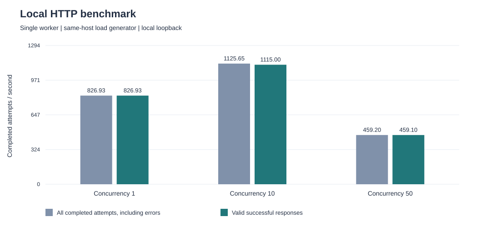

# 本机 HTTP 负载测试

本轮在同一台机器的回环地址上，以单 Uvicorn worker、客户端并发 1、10、50 测量公开只读的本地数值预测接口。它是本机软件与当前工作负载的观察记录，不是线上或 VPS 容量结论。压测进程保留生产相同的两槽推断闸门，仅在隔离子进程中放宽每 IP 窗口限流；生产服务、权重、阈值和线上限流配置不因此改变。

记录时间：`2026-11-01T20:10:42.275916+00:00`；源码提交：`2793a8dcabba93664f8d7cb0922b95ca044b455c`。模型：`v2-import-reviewed-seed42 / mlp16`，阈值 `0.5`。[机器可读原始汇总](../artifacts/load-test/results.json)。

## 本轮观测到的变化

成功吞吐呈非单调变化：并发 1、10、50 的成功 QPS 分别为 826.93、1115.00、459.10。这只是本轮三档观测，不能将最高一档数值视为已定位的容量上限。

并发 50 的成功 QPS 比并发 10 低 58.83%；成功 p95 从 21.250 ms 变为 352.476 ms。低错误率不能替代等待时间指标。

并发 50 共 27602 次请求，仅 6 次错误，错误率 0.02174%；busy 拒绝 6 次。该档全部完成尝试 QPS 459.20，与成功 QPS 459.10 接近。这些拒绝计数不足以把档间的大幅吞吐回落直接解释为观察到的 429；仍需区分客户端、服务处理及其间等待。

从并发 10 到 50，应用平均占用核为 0.620 → 0.268，压测器为 0.851 → 0.722。这是两个进程的平均 CPU 时间，既不是整机利用率，也不是瞬时热点或等待剖析。本记录没有证明 CPU 饱和；同机其他进程和短时资源争用也未受控。

两个场景结束后的应用线程数快照为 9 和 10。它们不是活动线程峰值、线程池上限或排队长度，不能据此断言线程池已经饱和。

本轮确认了端到端吞吐与尾延迟的变化，主瓶颈仍未定位。客户端调度、服务事件循环、连接或线程等待、HTTP 处理是待区分的环节；没有分阶段等待与活动时间，不能将下降归因于其中一个环节，也不据此更改生产槽位。

## 机器、配置与 VPS 参照

| 配置 | 本次记录 / 比较参照 |
| --- | --- |
| 操作系统 | macOS-15.7.9-arm64-arm-64bit-Mach-O |
| 架构 / 硬件型号 | arm64 / Mac14,5 |
| CPU | Apple M2 Max |
| 物理核 / 逻辑核 | 12 / 12 |
| 机器内存 | 32.00 GiB |
| Uvicorn workers | 1 |
| 监听 / 事件循环 / HTTP | 127.0.0.1 / asyncio / h11 |
| 数值库线程上限配置（非实测） | 1 |
| NumPy 构建 BLAS 身份 | accelerate / unknown |
| NumPy 构建 LAPACK 身份 | accelerate / unknown |
| 推断槽位 | 2 |
| 公开只读 / 外部模型 | 公开只读数值推断；本轮不调用 Jev 或 DeepSeek |
| 客户端模式 | closed-loop keep-alive round-robin AI-authored English SMS |
| 自编 fixture 条数 | 6 |
| 自编 fixture 字符长度 | 65–147 |
| 每轮预热请求数 | 100 |
| 生产每 IP 窗口限制 | 30 / 60 秒 |
| 隔离压测进程窗口限制 | 1000000000 / 60 秒 |
| 仓库 VPS 模板 CPU 配额 | 50% |
| 仓库 VPS 模板 MemoryHigh / MemoryMax | 192 / 256 MiB |
| 仓库 VPS 模板任务数 / 文件描述符 | 64 / 2048 |

依赖版本：anyio `4.15.1`，fastapi `0.152.0`，h11 `0.16.0`，httpx `0.28.1`，numpy `2.5.4`，python `3.13.3`，starlette `1.9.0`，uvicorn `0.54.0`。

VPS 一栏是仓库部署模板参照；本机没有等价复刻其 CPU 配额与内存限制。CPUQuota=50% 表示约半个 CPU 核的调度配额，不是本机一半的总核数。本轮没有远端并发请求，也没有覆盖 HTTPS 反向代理、跨网时延、其他服务争用、长期稳定性或生产默认每 IP 30 次/分钟限制下的真实访问分布。

## 请求与计时口径

输入来自 `examples/load_test_sms.json` 的 6 条自编短信，使用 keep-alive、闭环并发和轮转输入；并发数表示最多同时等待的请求，不是固定到达率。每轮先完成 100 次预热，预热请求不进入吞吐、时延和错误率。每轮另有 6 次自编 fixture 响应一致性预检，也不进入测量批次。CPU 差值的基线在预检和预热之后取得，生命周期 RSS 仍包括这些阶段。

每轮按记录的 duration_seconds 设定派发截止，窗口结束后停止新请求并等待已发出的请求结束。窗口 QPS 分别是 completed_in_window / duration_seconds 和 successful_in_window / duration_seconds；不把排空期间才完成的请求加进窗口吞吐。成功 p50/p95/p99 和错误率则覆盖窗口内发起的完整请求批次，包括排空阶段的完成或失败。错误率 = error_requests / issued_requests；HTTP 429、其他非成功状态、超时、连接错误和响应校验失败均应计入，不能只看快速拒绝得到的高 QPS。未知统计以 — 标记。

| 并发 | 派发窗口，s | 总墙钟，s | 停止派发后的排空，s | 发起请求 | 窗口内完成 / 成功 | 含排空最终完成 / 成功 / 错误 |
| ---: | ---: | ---: | ---: | ---: | ---: | ---: |
| 1 | 60.000 | 60.000 | 0.000 | 49617 | 49616 / 49616 | 49617 / 49617 / 0 |
| 10 | 60.000 | 60.004 | 0.004 | 67549 | 67539 / 66900 | 67549 / 66910 / 639 |
| 50 | 60.000 | 60.199 | 0.199 | 27602 | 27552 / 27546 | 27602 / 27596 / 6 |

## 吞吐、成功时延与错误

| 客户端并发 | 窗口完成尝试 QPS（含错误） | 窗口成功 QPS | 成功 p50 / p95 / p99，ms | 全请求错误率 | HTTP 429 / 其中 busy / 窗口限流 | 应用生命周期峰值 RSS，MiB |
| ---: | ---: | ---: | ---: | ---: | ---: | ---: |
| 1 | 826.93 | 826.93 | 1.179 / 1.374 / 1.637 | 0.00% | 0 / 0 / 0 | 64.39 |
| 10 | 1125.65 | 1115.00 | 6.850 / 21.250 / 35.219 | 0.95% | 639 / 639 / 0 | 67.70 |
| 50 | 459.20 | 459.10 | 62.851 / 352.476 / 591.657 | 0.02% | 6 / 6 / 0 | 64.78 |



- 并发 1：HTTP 状态 0=0, 200=49617, 429=0；错误分类 capacity_busy=0, minute_rate_limit=0, other_429=0, prediction_mismatch=0, timeout=0, transport_error=0。
- 并发 10：HTTP 状态 0=0, 200=66910, 429=639；错误分类 capacity_busy=639, minute_rate_limit=0, other_429=0, prediction_mismatch=0, timeout=0, transport_error=0。
- 并发 50：HTTP 状态 0=0, 200=27596, 429=6；错误分类 capacity_busy=6, minute_rate_limit=0, other_429=0, prediction_mismatch=0, timeout=0, transport_error=0。

成功时延仅使用有效成功响应；所有请求时延（含错误）另保存在原始汇总中，避免把快速 429 混入成功延迟后误报性能改善。一次、每级并发约 60 秒的观测不构成容量上限或 SLA。

## CPU、内存和条件性瓶颈分析

| 并发 | 应用 CPU 秒 / 平均占用核 | 压测器 CPU 秒 / 平均占用核 | 应用预热峰值 RSS，MiB | 应用线程数：前 / 后 |
| ---: | ---: | ---: | ---: | ---: |
| 1 | 26.439 / 0.441 | 27.890 / 0.465 | 61.48 | 2 / 2 |
| 10 | 37.224 / 0.620 | 51.084 / 0.851 | 63.58 | 2 / 9 |
| 50 | 16.148 / 0.268 | 43.450 / 0.722 | 61.48 | 2 / 10 |

压测器自身进程峰值 RSS：60.17 MiB；与应用进程分开记录。

应用峰值 RSS 来自新启动后端进程的操作系统生命周期高水位，包含启动、预热、测量和排空；不是定时采样得到的近似峰值，也不是仅测量窗口内的峰值。预热峰值单列，它已经包含模型加载和预热分配，不是空进程基线。压测器的进程峰值另列，不能直接相加当作精确物理内存总量，因为共享页可能重复计入。RSS 不等于模型权重大小或可用容量。

记录到 645 次明确的 busy 拒绝。保留的两槽推断闸门确实拒绝了这些并发尝试；这证明该闸门生效，不能单凭 429 推断 CPU、数值模型或公网吞吐已经饱和。

应用 CPU 秒与压测器 CPU 秒在上表分开。平均占用核表示进程 CPU 时间与对应墙钟的比值，1.0 约等于占用一个逻辑核，不是整台机器 100%。压测器与应用同机竞争调度资源；单 worker 的 HTTP 处理、线程调度、校验和序列化也消耗 CPU。没有独立进程剖析或分阶段计时，不能把观测曲线因果归为某一个阶段，也没有证明服务容量上限。

本轮 threadpool_info 记录为空列表，未提供可识别的数值库线程池信息。numeric_threads=1 是子进程启动时的环境线程上限配置；不能据此声称实际 BLAS 已验证为单线程。NumPy 后端摘要与环境配置保留在原始记录中。

NumPy 构建身份摘要：BLAS `accelerate`，LAPACK `accelerate`；runtime_threads_verified=`False`。这些名称只标识构建配置，不证明运行时线程数、具体调用路径或核心占用。构建版本 unknown 也不能自动补成系统或供应商版本。

原每 IP 滑动窗口仍在保存时间戳，而且在两槽闸门判断之前追加。放宽配额的本机测试可能产生比生产默认 30 次/分钟更大的队列；RSS 包含模型、HTTP 服务和这些请求簿记。本轮没有独立采集队列长度，因此这只是源码提示的可能因素；尚不能把 RSS 增长判为模型泄漏或唯一瓶颈。

## 复现与证据边界

复现使用独立公开数值模型包；包内只有服务清单、数值模型、词表、已有来源报告和压测用途标记，不包含工作数据库、快照或留出短信。自编 fixture 的摘要为 `c0a82a1bf8b2b28ddc35084b4997e690f5e2f80b5ae0ed51c60ac438f8595edf`。本轮无付费模型调用，也不使用 757 条最终测试集。

```sh
.venv/bin/python -B -m textlab.load_test --help
# 新的一轮本机测量，目标目录必须是新的独立目录。
.venv/bin/python -B -m textlab.load_test --output artifacts/load-test-new --duration 60 --warmup 100
# 仅按已有记录重建报告，不发压测请求。
.venv/bin/python -B -m textlab.load_test --replay artifacts/load-test/results.json
```

隔离服务入口为 `textlab.load_test_server:create_app`，需要 `SMS_LAB_LOAD_TEST=true`、`SMS_LAB_LOAD_TEST_HOST=127.0.0.1` 和显式独立包路径。这些标记只用于独立回环子进程；不把测试入口作为公开部署入口，也不修改生产源码常量。

完整性记录：来源模型文件未变 `True`；线上压测请求数 `0`。若附带 production_reference，它仅是只读元数据快照，不是对线上吞吐或资源容量的复核。

逐请求数值记录（不含短信内容）：

- 并发 1：[requests-c1.csv.gz](../artifacts/load-test/requests-c1.csv.gz)，SHA256 `683257315c35e96540950a921f0b0f7d6b072db400ffb72c5eef2b92c817a6a0`。
- 并发 10：[requests-c10.csv.gz](../artifacts/load-test/requests-c10.csv.gz)，SHA256 `0fe1e98a98cf87489d46c3782d74f58a72c735ba484eb1dc03ce4d96b8be8e9f`。
- 并发 50：[requests-c50.csv.gz](../artifacts/load-test/requests-c50.csv.gz)，SHA256 `8f64826b2993335f3a938e05f3d9f0e7acf5d2c1504893356e76708ffcf8c803`。

独立复算可读取压缩轨迹、检查计数与分位数，不启动服务或发送请求：

```sh
.venv/bin/python -B scripts/verify_load_test.py
```

[独立复算记录](../artifacts/load-test/verification.json)。
